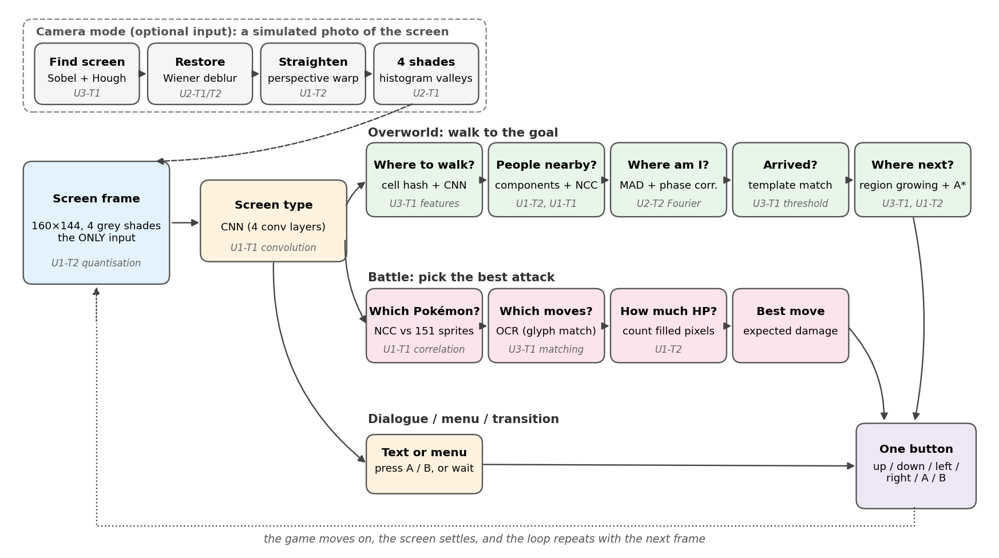
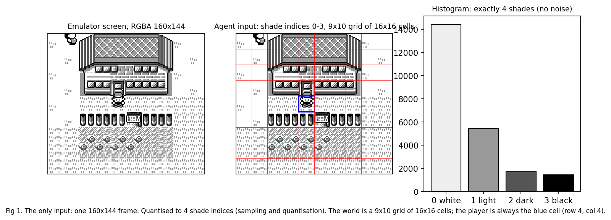
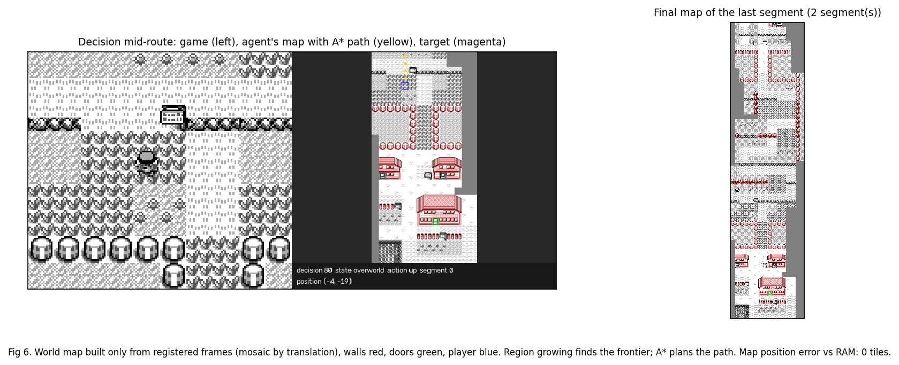

# PixelTrainer

**A vision-only agent that plays Pokémon Red from screen pixels.**

PixelTrainer starts in Pallet Town, walks north through Route 1, fights the wild Pokémon it meets, and stops when it recognises the Poké Center sign in Viridian City. It never reads the game's memory. Every decision comes from computer vision on the 160×144 screen image, and one button press comes out.

Computer Vision (MCA509D-5), CIA 3. Achindra Sharma, 2547105, 4MCA A.



## Results

All numbers come from recorded runs the models never saw in training, scored against the game's true state.

| What was measured | Result |
|---|---|
| Reached Viridian City (20 seeds × 3 battle strategies) | **60 / 60 episodes** |
| Screen type (16,432 unseen frames) | 99.49% correct |
| Walkable / blocked tiles (266,883 unseen cells) | 100% correct |
| People on the map | 100% precision, 97.5% recall |
| Position tracking (12,212 frames) | 0 tiles of error |
| Enemy species (716 test frames, 151 possible) | 100% correct |
| Camera mode, level 1 photo | 99.95% of pixels restored; goal reached in 3/3 runs |

## How it works

Each frame goes through these stages:

| Stage | Question | Method | Code |
|---|---|---|---|
| Screen state | Map, battle, dialogue, menu or transition? | Small CNN (heuristic baseline) | `perception/screen_state.py` |
| Tiles | Which 16×16 cells are walkable? | Exact-hash lookup + CNN | `perception/grid.py`, `tiles.py` |
| People | Who is in the way? | Connected components + NCC template matching | `perception/npc.py` |
| Position | How far did the screen scroll? | Phase correlation | `mapping/registration.py` |
| Map | What has been seen so far? | Registered mosaic of frames | `mapping/worldmap.py` |
| Planning | Where to go next, and how? | Region growing, frontiers, A* | `planning/` |
| Battle | Which Pokémon, how much HP, which move? | Template matching, OCR, HP-bar reading | `perception/battle.py`, `ocr.py`, `policy/` |
| Goal | Is the Poké Center sign on screen? | Template matching | `perception/landmark.py` |
| Camera mode | Turn a photo of the screen back into a clean frame | Localise, restore (Wiener etc.), rectify, quantise | `capture/` |

| Input | Output |
|---|---|
|  |  |
| One Game Boy frame, 4 grey shades, on a 16×16 cell grid | The map built from registered frames, with the planned path |

All nine input/output figures are in [`docs/figures/`](docs/figures/), and [`docs/INPUT_OUTPUT.md`](docs/INPUT_OUTPUT.md) explains each one.

## Setup (Windows, PowerShell)

You need Python 3.11 and your own dump of Pokémon Red. The ROM is not included for copyright reasons.

```powershell
python -m venv --system-site-packages .venv
.\.venv\Scripts\python -m pip install -r requirements.txt
copy <your dump>.gb roms\pokered.gb
.\.venv\Scripts\python tools\check_rom.py      # checks the ROM
.\.venv\Scripts\python -m pytest -q            # ROM-dependent tests skip without a ROM
```

Some files are not in this repository:
- **Trained models.** `models/screen_state.pt` and `models/tiles.pt` come with the submitted zip. Without them, retrain with `tools/train_screen_state.py` and `tools/train_tiles.py`. Both need the recorded dataset from `tools/record_dataset.py`.
- **Start state.** The agent starts from `states/pallet_start.state`, a save state made by hand with `tools/play.py` (`save pallet_start`). Save states come from the ROM, so they are not committed either.

## Running

| What you want | Command |
|---|---|
| Watch the agent play | `python -m pixeltrainer.run` |
| Record a demo video | `python -m pixeltrainer.run --headless --record runs/demo.mp4` |
| Another episode | `python -m pixeltrainer.run --seed 3 --policy greedy` (policies: `random`, `greedy`, `type`) |
| Camera-style input | `python evaluation/run_eval.py --input sim:1 --seeds 0-2` |
| Full evaluation | `python evaluation/run_eval.py --out runs/eval/final`, then `python evaluation/report.py runs/eval/final` |
| Regenerate the figures | `python tools/make_figures.py` |

Run these from the project folder with `.\.venv\Scripts\python`.

## Project layout

```
pixeltrainer/   the agent: sees pixels only
  perception/   screen state, tiles, people, battle, OCR, goal sign
  mapping/      registration and the world map
  planning/     exploration and A*
  policy/       battle move choice
  capture/      camera mode: find, restore, straighten the screen
evaluation/     scoring against the game's true state (the only code that reads RAM)
tools/          training, labelling, recording and figure scripts
tests/          unit tests
docs/           figures and the print style for the PDFs
```

**The one rule.** Code under `pixeltrainer/` decides from screen pixels only. Only `evaluation/` reads RAM, for labelling and scoring. `tests/test_ram_boundary.py` fails if the agent ever touches emulator memory.

## Documents

- [USER_MANUAL.md](USER_MANUAL.md): installation, a step-by-step explanation of the code, the input image and why it matters, and every output image with its justification.
- [Project_Synopsis.md](Project_Synopsis.md): the original idea.
- [PLAN.md](PLAN.md): the design.
- [BUILD.md](BUILD.md): the task list with each task's "done when" check.
- [REPORT.md](REPORT.md): evaluation results.

Pokémon Red is © Nintendo / Game Freak. This is a student project and is not affiliated with either.
