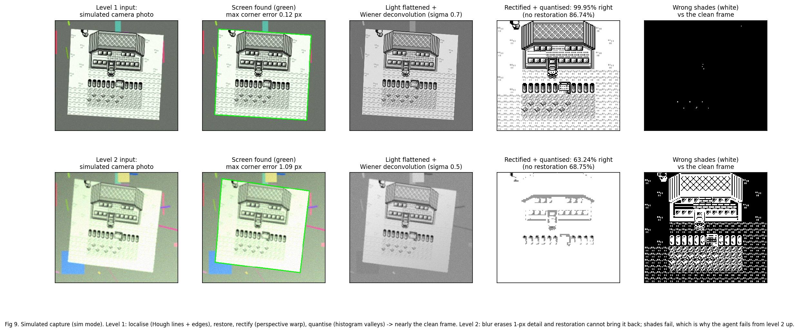
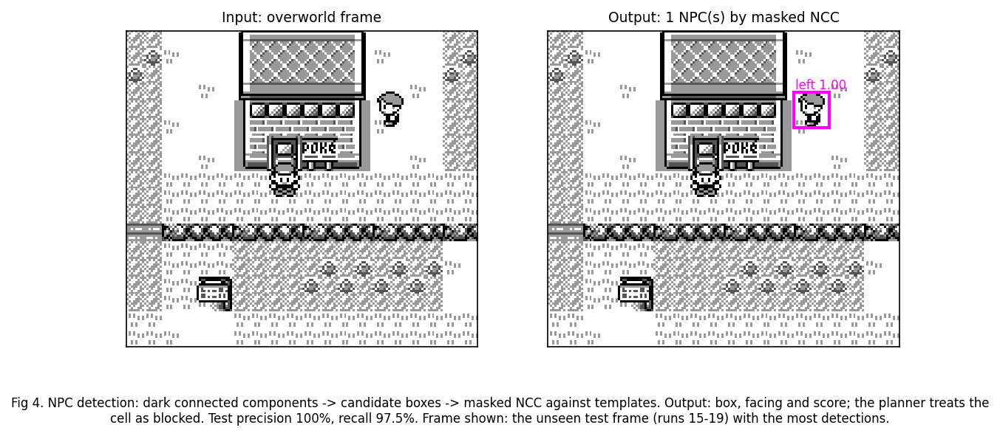
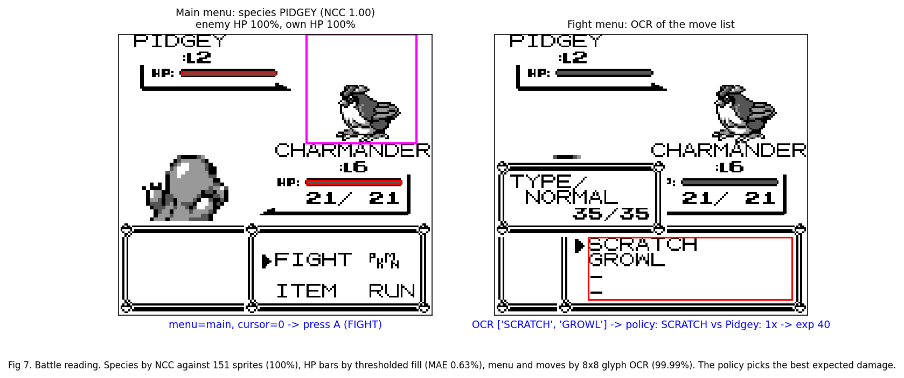

<div class="cover">
<h1 class="title">User Manual</h1>
<p class="sub">Computer Vision (MCA509D-5) — CIA 3</p>
<p class="sub">PixelTrainer — A Vision-Only Agent that Plays Pokémon Red</p>
<p>Achindra Sharma — 2547105 (Individual Submission)</p>
<p>4MCA A</p>
</div>

PixelTrainer is a program that plays Pokémon Red by **looking at the screen**, the way a person does. Every frame goes through a computer-vision pipeline that answers a few questions: what kind of screen is this, where can I walk, where am I, who is in the way, which Pokémon am I fighting, and have I reached the goal? Then the program presses one button. It starts in Pallet Town, walks north through Route 1, fights the wild battles on the way, and stops when it sees the Viridian City Poké Center sign.

The program never reads the game's memory. **Its only input is the screen image.**

Contents

1. Installation
2. Running the program
3. Explanation of the code
4. The input image and why it is necessary
5. Output images, with justification
6. Troubleshooting

---

## 1. Installation

Requirements: Windows 10/11, Python 3.11, and your own copy of the Pokémon Red ROM (not included, for copyright reasons).

```powershell
python -m venv --system-site-packages .venv
.\.venv\Scripts\python -m pip install -r requirements.txt
copy <your dump>.gb roms\pokered.gb
.\.venv\Scripts\python tools\check_rom.py      # checks the ROM
.\.venv\Scripts\python -m pytest -q            # 46 tests, all should pass
```

The trained models are `models/screen_state.pt` and `models/tiles.pt`. If they are missing (for example, in a fresh git clone), train them first: `python tools/train_screen_state.py` and `python tools/train_tiles.py`.

## 2. Running the program

All commands run from the project folder with the virtual environment's Python (`.\.venv\Scripts\python`).

| What | Command | What you get |
|---|---|---|
| Watch the agent play | `python -m pixeltrainer.run` | A game window at normal speed |
| Record a demo video | `python -m pixeltrainer.run --headless --record runs/demo.mp4` | `runs/demo.mp4`: the game on the left; the agent's map, plan and decision on the right |
| Change the seed or battle policy | `--seed 3 --policy greedy` (policies: `random`, `greedy`, `type`) | A different episode (wild encounters change with the seed) |
| Make the manual's figures | `python tools/make_figures.py` | `docs/figures/fig1…fig9.png` |
| Full evaluation | `python evaluation/run_eval.py --out runs/eval/final`, then `python evaluation/report.py runs/eval/final` | Tables for 20 seeds × 3 policies |
| Camera-like input | `python evaluation/run_eval.py --input sim:1 --seeds 0-2` | The same agent on degraded "photos" of the screen |

When an episode ends, the console prints one line, for example:

```
landmark seen after 133 decisions, 2 map segments, watchdog {}
```

- `landmark seen` means the goal was reached (`budget used up` means it was not).
- `decisions` is the number of buttons pressed.
- `map segments` is the number of separate map pieces the agent built.
- `watchdog` counts how many times the agent got stuck and pressed a random button (here, 0).

## 3. Explanation of the code

### 3.1 Folder layout

```
pixeltrainer/            the agent: sees pixels only
  emu.py                 emulator wrapper: frame in (4 shades), button out
  agent.py               decision loop (state machine)
  run.py, viz.py         command line, demo video
  perception/            what is on the screen
    screen_state.py      which of 5 screen types (CNN)
    grid.py, tiles.py    16x16 cells, walkable or blocked (lookup + CNN)
    npc.py               people on the map (connected components + NCC)
    battle.py, ocr.py    species, HP bars, menus, text
    landmark.py          goal sign (template matching)
  mapping/
    registration.py      how far the screen moved (phase correlation)
    worldmap.py          the map built from registered frames
  planning/
    explore.py           where to go next (region growing, frontier)
    astar.py             how to get there (A* search)
  policy/battle_policy.py  which attack to use
  capture/               camera mode: find, restore, straighten the screen
    localise.py, restore.py, rectify.py, quantise.py
evaluation/              scoring against the game's true state (the only code that reads RAM)
tools/                   training, labelling and figure scripts
tests/                   46 unit tests; test_ram_boundary.py fails if the agent reads RAM
```

### 3.2 One decision, step by step

The main loop is `run()` in `pixeltrainer/agent.py`. Each pass of the loop is one decision:

```
frame ─► [camera mode: localise ─► restore ─► rectify ─► quantise]
      ─► screen_state.cnn(frame)
           overworld  ─► tiles.lookup + npc.detect ─► WorldMap.update (registration) ─► landmark.seen?
                           ─► explore (region growing + frontier) ─► A* ─► first step of the path
           battle     ─► battle.menu / cursor / moves / species + ocr ─► battle_policy.choose ─► button
           dialogue   ─► A        menu ─► B        transition ─► wait
      ─► button pressed ─► emulator runs until the screen is still ─► next frame
```

1. **Get the frame.** `Emu.frame()` returns a 144×160 array of shade indices 0–3 (0 = white, 3 = black). In camera mode, the frame is first a simulated photograph, and `capture/` turns it back into this array (Section 4.3).
2. **Classify the screen** (`perception/screen_state.py`). A small CNN (4 strided convolution layers and 3×3 adaptive pooling) labels the frame overworld, battle, dialogue, menu or transition. The label decides which part of the pipeline runs next. A hand-written baseline (`heuristic`) matches 8×8 glyphs at fixed places, such as the battle HUD corners and the text-box border.
3. **Overworld: read the tiles** (`perception/grid.py`, `tiles.py`). The frame is cut into a 9×10 grid of 16×16 cells. `lookup` hashes each cell's exact pixels and looks the hash up in a table of 101 labelled cells: walkable, wall, grass, water, door, ledge or sign. A small CNN per cell (`tiles.cnn`) is the learned alternative. It is trained with ±1 px shifts and noise, so it also labels cells the table has never seen.
4. **Overworld: find people** (`perception/npc.py`).
   - Connected components of the darkest shade give candidate 16×16 boxes.
   - Each box is compared with sprite templates by masked normalised cross-correlation (NCC).
   - Overlapping hits are removed by IoU.
   - A detected person's cell counts as blocked, but only for a while, because people move.
5. **Overworld: update the map** (`mapping/registration.py`, `worldmap.py`).
   - One step scrolls the screen by exactly 16 px. `registration.step` finds the move (0, 1 or 2 cells in the pressed direction) by mean absolute difference.
   - When the frames are too noisy, it falls back to phase correlation (FFT).
   - A move of 0 px after a walk means the target cell is a wall.
   - Each frame is pasted into a mosaic at its offset, so the agent knows its own position without reading memory.
6. **Overworld: check the goal** (`perception/landmark.py`). The agent matches a template of the Poké Center sign (`cv2.matchTemplate`, normalised correlation). A score of 0.9 or more means the goal is reached, and the episode ends.
7. **Overworld: plan** (`planning/explore.py`, `astar.py`).
   - Region growing from the player's cell finds every reachable cell.
   - The frontier is the set of unknown cells next to the reachable region. Walking there reveals more map.
   - Each frontier cell is scored as progress towards the goal direction (north) minus 0.5 × its path distance. The best one is the target.
   - A* with a Manhattan heuristic plans the path. The first step of the path is the button to press.
8. **Battle** (`perception/battle.py`, `ocr.py`, `policy/battle_policy.py`).
   - OCR of 8×8 glyphs reads the menu type and the cursor position.
   - On the fight menu, the agent reads its moves and identifies the enemy species: NCC against all 151 front sprites.
   - The policy picks the move with the highest expected damage: power × same-type bonus × type effectiveness × accuracy.
   - HP bars are read as the fraction of filled pixels.
9. **Watchdog.** If nothing changes for 8 decisions, the agent presses a random button to get unstuck.

### 3.3 Course topics used

Every topic taught so far (Units 1 and 2, and Unit 3 Topic 1) is listed below with where it is used in the code. Methods in the agent's own loop are marked **(agent)**. The others are used in the camera-mode pipeline or in measured comparisons, which pick the method the agent uses.

| Syllabus topic | Where in the code | How it is used |
|---|---|---|
| **U1-T1** Simple image formation model | `evaluation/degrade.py`, `capture/restore.py` | A camera photo is modelled as g = h ∗ f + η (blur h, noise η). Uneven light multiplies the image (illumination × reflectance), so `flatten_light` divides it out. |
| U1-T1 Types of digital images | `emu.py`, `capture/` | RGBA emulator screen, then grey, then 4-level indexed image **(agent)**, plus binary masks (screen mask, dark-pixel mask). |
| U1-T1 Correlation and convolution | `perception/npc.py`, `battle.py`, `ocr.py`, `landmark.py`; `capture/restore.py`; CNNs | Template matching by normalised cross-correlation **(agent)**. Convolution in every spatial filter and in the CNN layers **(agent)**. |
| U1-T1 Fundamental steps / elements of an IP system | whole pipeline (Section 3.2) | Acquisition (emulator or photo), preprocessing (restore), segmentation (tiles, NPCs), recognition (species, OCR, landmark), interpretation (policy). |
| **U1-T2** Sampling and quantisation; resolution | `emu.py`, `capture/quantise.py`, `capture/rectify.py` | 4 grey levels mapped to shade indices **(agent)**. A photo is re-sampled back to 160×144 at pixel centres. |
| U1-T2 Neighbours and connectivity | `perception/npc.py`, `perception/grid.py`, `planning/explore.py` | 8-connected components of dark pixels give NPC candidates. 4-neighbour moves are used for the grid and the paths **(agent)**. |
| U1-T2 Distance measures | `planning/astar.py`, evaluation | Manhattan (city-block) distance is the A\* heuristic **(agent)**. Euclidean distance measures corner error. |
| U1-T2 Colour models | `capture/localise.py`, `restore.py` | BGR to grey conversion. Chromaticity (colour ÷ background model) separates the grey screen from coloured clutter. |
| U1-T2 Geometric transformations | `mapping/worldmap.py`, `capture/rectify.py` | Translation to paste frames into the map **(agent)**. Perspective warp to straighten a tilted photo. |
| **U2-T1** Grey-level transforms, point operations | `capture/restore.py`, `quantise.py` | Gamma correction. Multi-level thresholding into 4 shades. |
| U2-T1 Histogram processing and equalisation | `capture/quantise.py`, `restore.py` | Thresholds at the valleys of the log-histogram. Histogram equalisation and CLAHE are compared. |
| U2-T1 Degradation/restoration process; noise models | `evaluation/degrade.py` | Gaussian, salt-and-pepper and Poisson noise; defocus and motion blur; gamma; uneven light; colour cast; moiré. Levels 1 to 4. |
| U2-T1 Restoration in the presence of noise | `capture/restore.py` | Median and adaptive median filters; averaging of several frames. |
| U2-T1 Smoothing and sharpening spatial filters | `capture/restore.py` | Mean, Gaussian and median filters; unsharp masking; Laplacian sharpening. |
| **U2-T2** Fourier transform | `mapping/registration.py` | Phase correlation finds the shift between frames **(agent fallback)**. |
| U2-T2 Frequency-domain smoothing, sharpening and filters | `capture/restore.py` | Gaussian and Butterworth low-pass filters; FFT notch filter for moiré; Wiener deconvolution (in the camera chain). |
| U2-T2 Wavelets | `capture/restore.py` (`wavelet_denoise`) | 2-level Haar DWT with soft thresholding of the detail bands (BayesShrink). |
| **U3-T1** Local and global features | `perception/tiles.py`, `screen_state.py`, `quantise.py` | Local: one 16×16 cell or one sprite. Global: the whole-frame layout and the histogram. |
| U3-T1 Feature detection, description and matching | `perception/tiles.py`, `npc.py`, `battle.py` | Each cell is described by a hash of its pixels and matched in a table **(agent)**. Sprites and glyphs are matched by NCC **(agent)**. |
| U3-T1 Point, line and edge detection | `capture/localise.py` | Sobel gradient edges, Hough lines and line intersection find the screen corners in a photo. |
| U3-T1 Thresholding | `capture/quantise.py`, `localise.py`; detection scores | Histogram-valley thresholds. Threshold on the background difference. Score thresholds (NPC 0.8, landmark 0.9) **(agent)**. |
| U3-T1 Region growing | `planning/explore.py` | Grows the reachable region from the player's cell, and its border is the frontier **(agent)**. |
| U3-T1 Region splitting and merging | not used | It isn't needed. The game image already has a fixed 16×16 grid, so the "split" is given by the grid, and region growing does the merging. |
| CNN (promised in the synopsis) | `perception/screen_state.py`, `tiles.py` | Small CNNs classify the screen state and the tile classes **(agent)**. |

The restoration methods are compared in `evaluation/eval_restore.py` (PSNR, SSIM and shade accuracy for each method × degradation type). The comparison chose flatten-light + Wiener as the camera chain. Wavelet shrinkage gives the best single-photo SSIM on Gaussian noise (0.914 → 0.933) and Poisson noise (0.771 → 0.808). It is not in the chain, because quantisation already gets 99–100% of shades right on those noise types.

### 3.4 How the code was checked

- The game's memory (RAM) is read only by `evaluation/`, for two jobs: labelling training data offline (runs 0–14) and scoring the agent.
- Test numbers come from runs 15–19, which were never used in training.
- `tests/test_ram_boundary.py` fails if any agent module touches the emulator's memory.

The headline numbers are in `REPORT.md`:
- 60/60 episodes reached Viridian City
- screen state 99.49%
- tiles 100%
- NPC precision 100% and recall 97.5%
- species 100%
- HP error 0.63%
- map position error 0 tiles

---

## 4. The input image and why it is necessary

### 4.1 What the input is


The input is **one 160×144 Game Boy frame per decision**, with nothing else alongside it.
- `Emu.frame()` maps the emulator's 4 grey levels (255, 153, 85, 0) to shade indices 0, 1, 2, 3 (Fig 1, middle).
- The histogram (Fig 1, right) has exactly four bars and no values in between. A clean frame is therefore exact: the same tile always gives the same pixels.

Three properties of this image make the whole pipeline possible:

1. **A fixed 16×16 grid.** The map is built from 16×16 cells, and the camera follows the player. The frame is therefore always a 9×10 grid aligned at (0, 0) (red lines in Fig 1), and the player is always in cell (row 4, column 4) (blue box). Tile classification, NPC boxes and map positions are all done per cell.
2. **Exact shades.** With exactly 4 shades and no noise, a cell's pixels can be hashed and looked up, and template matching scores reach 1.00 on a true match (Figs 4, 7, 8).
3. **Exact scrolling.** A step moves the image by exactly 16 px. Registration can therefore turn two frames into a move of whole cells (Fig 5).

### 4.2 Why the image is necessary (and why nothing else is used)

- **It is the only information the agent has.** The project rule is "pixels only". The game's memory holds the player's position, the map, the enemy and its HP, but the agent may not read it (Section 3.4). Every fact the agent uses is therefore measured from the image:
  - where the player is, by registration of consecutive frames
  - what is walkable, from the tile classes
  - who is in the way, by NPC detection
  - what to attack, by species and OCR
  - when to stop, from the landmark
- **Each stage needs a specific part of the image:**

  | Stage | Part of the image it needs | Without it |
  |---|---|---|
  | Screen state | the whole frame (layout: HUD, text box, black fade) | The agent would not know whether to walk, fight or press A |
  | Tiles | each 16×16 cell | No walkable/blocked map, so no path |
  | NPCs | dark sprite pixels and their shapes | The agent would walk into people and treat them as walls |
  | Registration | two consecutive frames | No position, so no map |
  | Battle | sprite box (56×56), HP bar rows, text rows | Unknown enemy, unknown moves, so no choice of attack |
  | Landmark | the sign's pixels | The agent would never know it had arrived |

- **The frame must be still.** Before the agent decides, the emulator runs until no new screen appears for 8 frames and the screen is not blank (`Emu.wait_until_stable`). A frame caught mid-scroll would break the 16-px grid.

### 4.3 The second input: a simulated camera photo



A clean screen grab needs no image restoration. To make the taught restoration methods do real work, the program can also take a **simulated photograph of the screen** (`--input sim:<level>`, `evaluation/degrade.py`).
- The photo follows the model `g = h * f + η`.
- The screen is tilted onto a cluttered background, blurred (h), lit unevenly, colour-cast, overlaid with moiré, and given noise (η).
- Levels 1–4 increase every degradation.

This input is necessary because it is the realistic case: a camera pointed at a real Game Boy. It cannot be handled by grid and hash methods directly, because the grid is tilted, the shades are no longer 4 values, and nothing repeats exactly. It needs four steps to become a clean frame again: localisation, restoration, rectification and quantisation (Section 5.8).

### 4.4 What makes a good or bad input

| Input | Result |
|---|---|
| Clean emulator frame, still | Works (60/60 episodes) |
| Simulated photo, level 1 (slight tilt, defocus, noise, colour cast) | Works (3/3 episodes with restoration) |
| Simulated photo, level 2 and above (strong blur, gamma, uneven light, motion blur, moiré) | Fails: blur erases 1-px details, so shades cannot be recovered (Fig 9, bottom row) |
| Frame taken during a scroll or fade | Not used: the program waits for a still frame |
| A different game, or the Game Boy Color palette | Not supported: the templates and tile labels are for Pokémon Red's 4-shade palette |

---

## 5. Output images, with justification

Every figure below is made by `python tools/make_figures.py` from a real run (seed 0) or from the unseen test runs. In each figure the input is on the left and the output on the right. Each section says how to read the figure, then explains why the output is correct.

### 5.1 Screen state


**Shows.** Five frames from test run 18, one per class. Each has three labels: its true label (from the offline labels), the CNN's output and the heuristic's output. All five are correct.

**Justification.**
- The screen state comes first because every later stage only makes sense on one kind of screen. Tile classes are meaningless in a battle, and OCR of a move list is meaningless on the map.
- The classes look very different in the image: a full map, a HUD with sprites, a text box over the map, a text box over a menu, or a nearly uniform black or white fade. A CNN that keeps a 3×3 spatial layout separates them.
- On 16,432 unseen frames, the CNN is right 99.49% of the time. The glyph heuristic is right 95.36% of the time, because it misses battle frames where the HUD has not appeared yet.

### 5.2 Tile classes


**Shows.** The Pallet Town start frame, its lookup labels (87 of 90 cells known) and its CNN labels (all 90 cells).
- Green is walkable; red is wall (house, fence); cyan is the sign; amber is the door (CNN).
- The player's cell is hatched in blue. Sprite cells are masked, because the sprite hides the ground.

**Justification.**
- The labels match what is visible: the house and fence are blocked; the path, grass edge and flower bed are walkable.
- The lookup leaves 3 cells unknown (grey): the house door, the player's cell and an NPC clipped at the top-left edge. Sprites change a cell's pixels, so the exact hash misses. The CNN labels every cell, and it correctly calls the door a door.
- On the unseen test runs (266,883 cells), both methods agree with the game's own collision data on 100% of cells. The lookup is exact but only finds 97.6% of cells; the CNN covers all of them.
- One visible error: the CNN colours the NPC clipped at the top-left edge as wall. The NPC detector needs a whole sprite, so this half-visible one is not masked, and the CNN sees sprite pixels instead of ground. The cell is still correctly *blocked* (an NPC stands there), so the planner is not misled; it is a labelling limit, not a path error.
- This walkable/blocked grid is what the planner searches, so a wrong label here would send the agent into a wall.

### 5.3 NPC detection



**Shows.** A Viridian City test frame with the detected person boxed in magenta. The label gives the facing (`left`) and the NCC score (1.00). The player in the centre is not reported, because the player is always masked.

**Justification.**
- An NPC is not a wall: it moves. The planner marks its cell as blocked with low confidence, so the agent steps around the person and tries the cell again later.
- The NCC score of 1.00 means the box matches a template exactly. The detection threshold is 0.8.
- On unseen test runs, detection has 100% precision, 97.5% recall and 99.1% correct facing. All 9 misses are one NPC whose lower half is hidden by tall grass (score 0.74).

### 5.4 Registration (where am I?)


**Shows.** Two frames before and after pressing **up**. The panels show:
- the phase-correlation surface: one sharp peak at dx = 0, dy = +16 px, response 0.83
- the result: a move of (0, −1) cells
- the difference between frame t+1 and frame t shifted by 16 px

**Justification.**
- The peak is exactly one cell (16 px) and opposite to the walk. When the player walks up, the content moves down, which matches the move pressed.
- After alignment the difference image is black almost everywhere. What remains is the new row revealed at the top and the player sprite, which does not move on screen. Everything else lines up, so the shift is right.
- Over 10,770 test steps, phase correlation alone was right 10,766 times; with the direction prior, all 10,770. This is why the map never drifted: the map position error against the game's memory was 0 tiles on 12,212 frames.

### 5.5 World map and plan


**Shows.**
- Left: the demo-video view at decision 80. The game is on one side; on the other is the agent's map, with the A* path in yellow and the frontier target in magenta.
- Right: the final map of the last segment.
- Walls are tinted red, doors green, and the player is boxed in blue.

**Justification.**
- The map was built only by pasting registered frames at their offsets. It still shows Pallet Town, the fence line and Route 1 joined correctly, with no seams or doubled tiles. That is visible proof that registration is right.
- The yellow path goes north through walkable cells and stays out of red cells, as the goal direction requires.
- The agent made the trip in 133 decisions with 2 map segments, and the watchdog never fired. A new segment starts when a frame cannot be placed on any known segment, for example after walking through a door into a building.

### 5.6 Battle reading and choice



**Shows.**
- Main menu: the enemy sprite box is read as **PIDGEY** with NCC 1.00, both HP bars read 100%, and the cursor is on FIGHT, so the agent presses A.
- Fight menu: OCR reads the moves `['SCRATCH', 'GROWL']`. The policy explains its choice: "SCRATCH vs Pidgey: 1x -> exp 40".

**Justification.**
- The readings match the screen: the name printed at the top is PIDGEY, both bars are full, and the move list shows SCRATCH and GROWL.
- SCRATCH is the right choice. GROWL does no damage, and SCRATCH (power 40, Normal type) is neutral (1×) against a Normal/Flying Pidgey.
- On unseen tests: species 100% (716/716), HP bar mean error 0.63%, and OCR 99.99% on text actually drawn on screen.

### 5.7 Goal reached


**Shows.** The Poké Center sign template (left) and the last frame of the episode (right). The best match is boxed in green, with NCC 1.000, which is at least the 0.9 threshold. The agent stops.

**Justification.**
- The box sits exactly on the "POKé" sign in the top-right corner.
- The score of 1.000 means a pixel-exact match. The threshold of 0.9 leaves room for small differences but not for a different sign.
- In the final evaluation, all 60 episodes (20 seeds × 3 battle policies) ended here.

### 5.8 Camera mode: from photo back to a frame


**Shows.** Each row runs one simulated photo through the four steps:
1. Localise: the green outline is the screen found by background subtraction, Hough lines and edge refinement.
2. Restore: flatten the lighting, then Wiener deconvolution with the blur σ chosen automatically.
3. Rectify: warp the screen back to 160×144.
4. Quantise: map back to 4 shades at the histogram valleys.

The last panel marks in white every pixel whose shade differs from the clean frame.

**Justification.**

- **Level 1 (top row): success.**
  - The corners are found within 0.12 px.
  - After restoration, 99.95% of pixels get the right shade, against 86.74% without it. Restoration removes almost all the errors; only a dozen isolated pixels stay wrong.
  - Downstream, the tile hashes and templates match again, and the agent reaches Viridian in 3/3 seeds with restoration (2/3 without it).
- **Level 2 (bottom row): failure, shown on purpose.**
  - The corners are still found within 1.09 px.
  - The stronger blur erases the 1-px details of the tiles, so quantisation recovers only 63.24% of shades, and the grass and walls disappear.
  - Restoration cannot recover detail that the blur destroyed. Here it scores slightly lower than no restoration (68.75%).
  - This is the real limit of the system: from level 2 up the agent fails (Section 7 of `REPORT.md`). Showing it explains why the level-1 output can be trusted and where the method stops working.

### 5.9 Demo video

`runs/demo.mp4` (made by `python -m pixeltrainer.run --headless --record runs/demo.mp4`) shows the whole episode at 4 decisions per second. Each frame has the same layout as Fig 6 (left): the game, the map growing as the agent explores, the planned path, and a status line with the decision number, screen state, button, map segment, and (in battles) the reason for each move.

---

## 6. Troubleshooting

| Problem | Cause | Fix |
|---|---|---|
| `FileNotFoundError: roms/pokered.gb` | No ROM | Copy your own Pokémon Red dump to `roms/pokered.gb` |
| `FileNotFoundError: models/...pt` | Models not trained (they are not in git) | `python tools/train_screen_state.py`, `python tools/train_tiles.py` (needs the recorded data in `data/raw/`) |
| `budget used up` | The episode ran past 1,500 decisions | Raise it with `--max 3000`, or try another `--seed` |
| The agent stands still in camera mode | Level 2 or higher: shades cannot be recovered | Use `--input sim:1` or clean frames |
| `ModuleNotFoundError: evaluation` | Run from another folder | Run from the project root |
