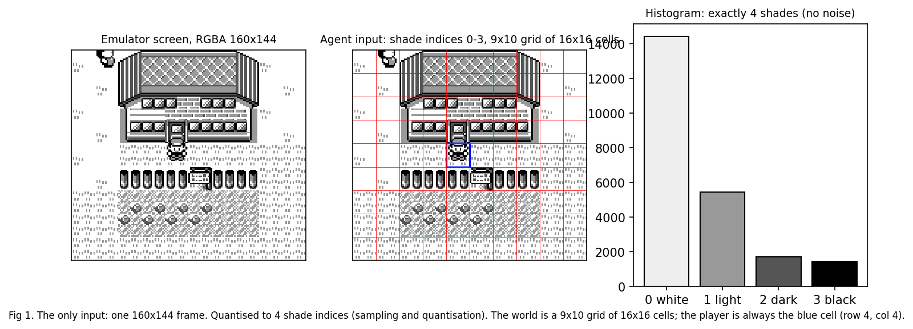
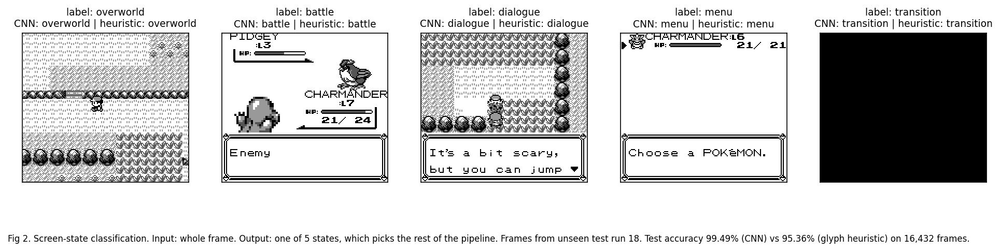
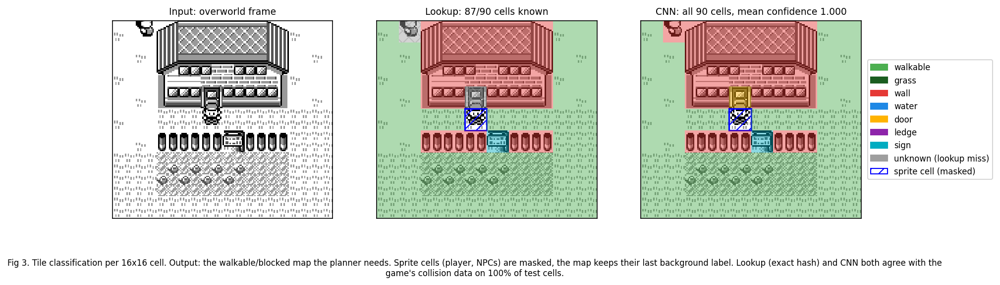
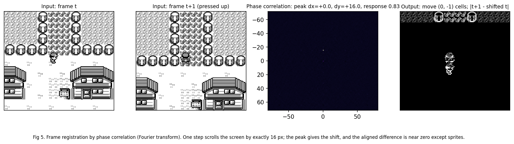
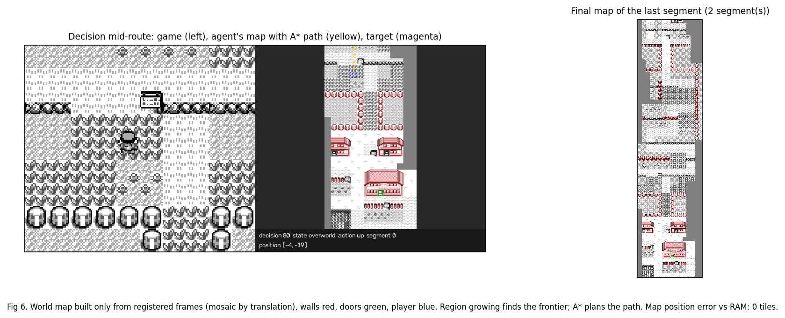
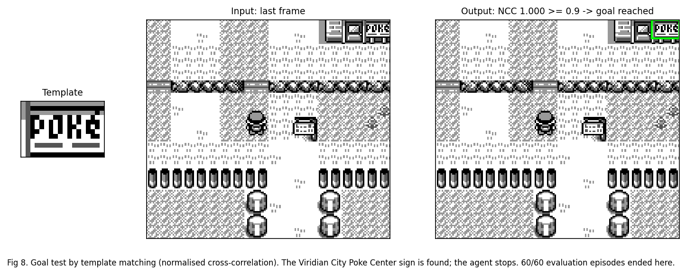

<div class="cover">
<h1 class="title">User Manual</h1>
<p class="sub">Computer Vision (MCA509D-5) — CIA 3</p>
<p class="sub">PixelTrainer — A Vision-Only Agent that Plays Pokémon Red</p>
<p>Achindra Sharma — 2547105 (Individual Submission)</p>
<p>4MCA A</p>
<p>Repository: <a href="https://github.com/Achindra2003/pixeltrainer">github.com/Achindra2003/pixeltrainer</a></p>
</div>

## About the project

Most game-playing bots cheat a little. They read the game's memory, so they know exactly where the player is, what the map looks like and how much HP the enemy has. I wanted to build one that doesn't. **PixelTrainer plays Pokémon Red only by looking at the screen**, the same way a person does, so every piece of information it uses has to come from computer vision.

The task I set it is the first real journey in the game. It starts in Pallet Town, walks north through Route 1, fights the wild Pokémon that jump out of the grass, and stops when it sees the Poké Center sign in Viridian City. For every frame the program asks itself a few questions:

- What kind of screen is this: the map, a battle, a dialogue box or a menu?
- Where can I walk, and where am I?
- Is anyone standing in my way?
- If I'm in a battle, which Pokémon am I fighting and which move should I use?
- Have I reached the goal yet?

Each answer comes from an image processing technique we covered in class. Once all of them are answered, the program presses one button and the loop starts again.

This manual covers how to install and run the program (Sections 1–2), how the code works (Section 3), why the input image is so important (Section 4), and what each output image shows and why it is correct (Section 5).

---

## 1. Installation

You need Windows 10 or 11, Python 3.11 and your own copy of the Pokémon Red ROM. I can't include the ROM for copyright reasons.

```powershell
python -m venv --system-site-packages .venv
.\.venv\Scripts\python -m pip install -r requirements.txt
copy <your dump>.gb roms\pokered.gb
.\.venv\Scripts\python tools\check_rom.py      # checks the ROM
.\.venv\Scripts\python -m pytest -q            # 47 tests, all should pass
```

The two trained models are `models/screen_state.pt` and `models/tiles.pt`. They come with the submitted zip. On a fresh clone from GitHub they are missing, and you can retrain them with `python tools/train_screen_state.py` and `python tools/train_tiles.py`.

## 2. Running the program

Run every command from the project folder, using the virtual environment's Python (`.\.venv\Scripts\python`).

| What you want | Command | What you get |
|---|---|---|
| Watch the agent play | `python -m pixeltrainer.run` | A game window at normal speed |
| Record a demo video | `python -m pixeltrainer.run --headless --record runs/demo.mp4` | A video with the game on the left and the agent's map, plan and decisions on the right |
| Try a different run | `--seed 3 --policy greedy` (policies: `random`, `greedy`, `type`) | A different episode, because the wild encounters change with the seed |
| Regenerate the figures | `python tools/make_figures.py` | `docs/figures/fig1…fig9.png` |
| Full evaluation | `python evaluation/run_eval.py --out runs/eval/final`, then `python evaluation/report.py runs/eval/final` | Result tables for 20 seeds × 3 policies |
| Camera-style input | `python evaluation/run_eval.py --input sim:1 --seeds 0-2` | The same agent playing from degraded "photos" of the screen |

When an episode ends, the console prints a one-line summary, for example:

```
landmark seen after 133 decisions, 2 map segments, watchdog {}
```

This means the agent reached the goal after pressing 133 buttons. It built 2 separate pieces of map on the way, and it never got stuck (the watchdog never had to step in). If the goal is not reached in time, the line says `budget used up` instead.

## 3. Explanation of the code

### 3.1 How the project is organised

I split the code by job. Everything the agent uses lives in `pixeltrainer/`. Anything that is allowed to look at the game's real memory, for scoring and labelling, is kept separate in `evaluation/`.

```
pixeltrainer/            the agent: sees pixels only
  emu.py                 emulator wrapper: frame in (4 shades), button out
  agent.py               decision loop (state machine)
  run.py, viz.py         command line, demo video
  perception/            what is on the screen
    screen_state.py      which of 5 screen types (CNN)
    grid.py, tiles.py    16x16 cells, walkable or blocked (lookup + CNN)
    npc.py               people on the map (connected components + NCC)
    battle.py, ocr.py    species, HP bars, menus, text
    landmark.py          goal sign (template matching)
  mapping/
    registration.py      how far the screen moved (phase correlation)
    worldmap.py          the map built from registered frames
  planning/
    explore.py           where to go next (region growing, frontier)
    astar.py             how to get there (A* search)
  policy/battle_policy.py  which attack to use
  capture/               camera mode: find, restore, straighten the screen
    localise.py, restore.py, rectify.py, quantise.py
evaluation/              scoring against the game's true state (the only code that reads RAM)
tools/                   training, labelling and figure scripts
tests/                   47 unit tests; test_ram_boundary.py fails if the agent reads RAM
```

### 3.2 What happens in one decision

The main loop is `run()` in `pixeltrainer/agent.py`. Each time round the loop, the agent looks at one frame and presses one button:

```
frame ─► [camera mode: localise ─► restore ─► rectify ─► quantise]
      ─► screen_state.cnn(frame)
           overworld  ─► tiles.lookup + npc.detect ─► WorldMap.update (registration) ─► landmark.seen?
                           ─► explore (region growing + frontier) ─► A* ─► first step of the path
           battle     ─► battle.menu / cursor / moves / species + ocr ─► battle_policy.choose ─► button
           dialogue   ─► A        menu ─► B        transition ─► wait
      ─► button pressed ─► emulator runs until the screen is still ─► next frame
```

Here is each step in plain words.

1. **Grab the frame.** `Emu.frame()` gives a 144×160 image in which every pixel is one of four shades, 0 (white) to 3 (black). In camera mode the input is a simulated photo instead, and the `capture/` module first turns it back into this clean form (Section 4.3).

2. **Work out what kind of screen it is** (`perception/screen_state.py`). This decides everything that follows, because walking logic is useless in a battle and battle logic is useless on the map. I trained a small CNN (four convolution layers) to sort each frame into overworld, battle, dialogue, menu or transition. I also wrote a simple hand-made version that checks for fixed patterns, like the corners of the battle display, so I could compare the two.

3. **Figure out where it can walk** (`perception/grid.py`, `tiles.py`). The game world is made of 16×16 tiles, so I cut the frame into a 9×10 grid of cells. The fast method takes a fingerprint (hash) of each cell's pixels and looks it up in a table of 101 cells I labelled: walkable, wall, grass, water, door, ledge or sign. As a backup I also trained a small CNN on single cells. It still gives an answer when a cell looks slightly different from anything in the table.

4. **Spot other people** (`perception/npc.py`). Character sprites have dark outlines, so I first group touching dark pixels together (connected components) to get candidate boxes. Each box is then compared against the character templates using normalised cross-correlation (NCC). A person's cell is treated as blocked, but only for a while, because people walk around.

5. **Keep track of position and build a map** (`mapping/registration.py`, `worldmap.py`). The agent never reads its coordinates from memory, so it has to work them out. Every step scrolls the screen by exactly 16 pixels. By comparing the new frame with the previous one, the agent can tell whether it moved 0, 1 or 2 cells. When the frames are too noisy for a direct comparison, it falls back to phase correlation, which uses the Fourier transform. If it pressed a direction and moved 0 pixels, it walked into a wall. Each frame is then pasted into a growing map at the right offset.

6. **Check whether it has arrived** (`perception/landmark.py`). The agent compares the screen against a template of the Poké Center sign. If the match score is 0.9 or higher, the goal is reached and the episode ends.

7. **Decide where to go** (`planning/explore.py`, `astar.py`). Starting from the player's cell, region growing marks every cell the agent can reach. The unknown cells along the edge of that region (the "frontier") are where new map gets revealed. The agent scores each frontier cell by how far north it is, minus a cost for how far away it is, and picks the best one. A* search with Manhattan distance then finds the path, and the first step of that path is the button to press.

8. **Fight battles** (`perception/battle.py`, `ocr.py`, `policy/battle_policy.py`). The agent reads the menu text with OCR, so it knows which menu is open and where the cursor is. It identifies the enemy Pokémon by matching the sprite against all 151 front sprites, and reads both HP bars by counting filled pixels. It then picks the move with the highest expected damage: power × same-type bonus × type effectiveness × accuracy.

9. **Get unstuck.** If nothing on screen changes for 8 decisions, a watchdog presses a random button. It is a safety net for the rare cases where the agent gets stuck.

### 3.3 The algorithms behind each step, and why I chose them

Most computer vision topics have several well-known algorithms. Feature description alone could mean SIFT, ORB, HOG or a CNN. A key part of this project was choosing the *right* one for each job, so this section explains exactly what my code does at each stage and why.

The guiding idea came from looking at the input (Section 4). A Game Boy screen is **exact**: it has only 4 shades, a fixed grid, and no noise or rotation. General-purpose methods like SIFT or YOLO are designed to cope with messy real-world photos, and that robustness isn't needed here. So for the clean screen I used the simplest method that is exactly right. I kept the heavier, more robust methods for camera mode, where the input really is messy.

**1. Tile types: feature description and matching** (`perception/grid.py`, `tiles.py`)

- *Descriptor:* each 16×16 cell's 256 shade values are hashed (BLAKE2b, 8 bytes). The hash is the cell's fingerprint.
- *Matching:* a dictionary lookup in a table of 101 cells I labelled by hand. A cell that isn't in the table is marked "unknown".
- *Why not SIFT, ORB or HOG?* Those descriptors are built to survive rotation, scaling and lighting changes, and none of that happens on this screen. The same tile always produces the same 256 values, so an exact hash is both perfect and instant.
- *Backup CNN:* 3 convolution layers (16, 32 and 64 filters, 3×3) with batch normalisation and ReLU, followed by a fully connected layer for the 9 classes. I flatten the features instead of pooling them away, so the network keeps track of *where* a pattern sits in the cell (a ledge's edge is always at the bottom). I trained it with ±1 pixel shifts, so it still works on cells the table has never seen.

**2. Screen type: a CNN** (`perception/screen_state.py`)

- 4 convolution layers with stride 2 (5×5, then 3×3 kernels), then average pooling down to a 3×3 grid, then a fully connected layer for the 5 classes.
- *Why pool to 3×3 instead of 1×1?* The layout is what tells the screens apart. A battle has its display in the corners, and dialogue has a text box along the bottom. A 3×3 grid keeps that rough layout.

**3. Finding people: connected components + normalised cross-correlation** (`perception/npc.py`)

1. Take every black (shade 3) pixel, since all character sprites have black outlines.
2. Group touching black pixels into 8-connected components (`cv2.connectedComponentsWithStats`) and drop tiny specks.
3. Each sprite-sized box that touches a component becomes a candidate.
4. Score each candidate against every sprite template with **masked NCC**: NCC = Σ(a − ā)(b − b̄) / √(Σ(a − ā)² · Σ(b − b̄)²), counting only the pixels inside the sprite's outline, so the ground behind it doesn't matter.
5. A score of 0.8 or more is a person. The best-matching template also tells me which way they are facing (I have one template per direction).
6. Overlapping duplicate boxes are removed using intersection over union (IoU > 0.5).

*Why not a trained detector like YOLO?* There are only a handful of known sprites, and NCC is unaffected by brightness and contrast. A deep detector would need far more data and would be no more accurate here.

**4. Working out position: block matching + phase correlation** (`mapping/registration.py`)

- *Main method:* the agent knows which button it pressed, so it can only have moved 0, 1 or 2 cells in that direction. For each option it shifts the old frame by that many 16-pixel cells, measures the mean absolute difference (MAD) with the new frame (ignoring the player's own cell), and picks the smallest.
- *Fallback, phase correlation* (`cv2.phaseCorrelate`), for noisy frames. It takes the Fourier transform of both frames and computes the normalised cross-power spectrum. By the Fourier shift theorem, the inverse transform of that has a sharp peak exactly at the shift.
- *Why both?* Grass and paths repeat every 16 pixels, so phase correlation on its own sometimes mistakes a real step for no movement. It was right 10,766 times out of 10,770. With the pressed direction as a hint, it was right all 10,770 times.

**5. Planning: region growing + A\* search** (`planning/explore.py`, `astar.py`)

1. Seed a region at the player's cell and keep adding 4-connected neighbours that are walkable. A ledge can only be crossed in the direction you jump off it.
2. The **frontier** is the set of unknown cells touching the grown region.
3. Each frontier cell is scored as (progress north) − 0.5 × (steps to reach it), and the best one becomes the target.
4. A\* search, using a priority queue and the Manhattan distance |dx| + |dy| as its heuristic, finds the path. The first step of the path is the button to press.

**6. Battles: NCC, glyph matching and pixel counting** (`perception/battle.py`, `ocr.py`)

- *Species:* NCC of the 56×56 enemy sprite box against all 151 Pokémon front sprites. Each sprite is mean-centred and normalised beforehand, so a single matrix multiplication scores all 151 at once.
- *OCR:* the game's text sits on an 8×8 grid in one fixed font. Each 8×8 tile is matched exactly against the font first. If that fails, it takes the closest glyph by **Hamming distance** (the number of pixels that differ), as long as no more than 6 pixels differ. Anything further away isn't text.
- *HP:* count the filled pixels (shade 2 or darker) along the 48-pixel bar and divide by 48.

**7. Reaching the goal: template matching with a threshold** (`perception/landmark.py`)

- `cv2.matchTemplate` with normalised correlation against the "POKé" sign. A score of 0.9 or more means the agent has arrived.

**8. Camera mode: localise, restore, rectify, quantise** (`capture/`)

- *Finding the screen* (`localise.py`):
  1. Fit a flat plane (a + bx + cy) to the border of the photo for each colour channel. This is the background model.
  2. Pixels more than 20 grey levels away from that model are screen. This is thresholding.
  3. Clean up the mask (opening, then closing) and take the largest contour.
  4. Find its 4 sides with the Hough line transform.
  5. Refine each side to sub-pixel accuracy by searching the Sobel gradient along the side's normal, then fit a straight line through those points.
  6. The 4 corners are where neighbouring lines intersect.
- *Restoration* (`restore.py`):
  1. Divide by the background plane, which evens out uneven light and colour cast in one step.
  2. Apply Wiener deconvolution with a Gaussian blur kernel. The blur width isn't known, so the code tries several values (σ from 0 to 1.8) and keeps the one whose result looks most like 4 clean shades.
- *Straightening* (`rectify.py`): a 4-point perspective transform maps the corners back to a flat 160×144 screen, sampling at each pixel's centre.
- *Back to 4 shades* (`quantise.py`):
  1. Take the histogram, log-scale it and smooth it.
  2. Find the 4 strongest peaks; the threshold between two shades is the lowest valley between their peaks.

  I also tried multi-Otsu, but it merged rare shades and split spread-out ones, so the valley method won.

**Summary of my choices**

| Concept | Common alternatives | What I used | Why |
|---|---|---|---|
| Feature description | SIFT, ORB, HOG | Exact pixel hash | The screen is exact, so no invariance is needed |
| Feature matching | k-nearest neighbours, FLANN | Hash lookup, NCC, Hamming distance | Exact and fast on a fixed palette |
| Object detection | YOLO, Haar cascades | Connected components → masked NCC | Few known sprites, and no training data needed |
| Registration | Feature matching, optical flow | Block MAD + phase correlation | Moves are always whole cells |
| Edge and line detection | Canny, LSD | Sobel + Hough + sub-pixel refinement | Corners to within 0.12 px on level-1 photos |
| Thresholding | Otsu, adaptive | Histogram valleys | Handles rare and spread-out shades |
| Segmentation | Watershed, split-and-merge | Region growing | Grows directly over the tile grid |
| Classification | SVM, k-nearest neighbours | Small CNNs | Learns layout and texture together |
| Restoration | Inverse filter, median | Light flattening + Wiener with blind σ | Best in my measured comparison |

### 3.4 How the course topics fit in

When I planned the project, I tried to use the topics we covered in class wherever they actually solved a problem, rather than adding them just to tick boxes. The table below goes through every topic taught so far (Units 1 and 2, and Unit 3 Topic 1) and shows where it appears. Rows marked **(agent)** run while the agent is playing. The others are in the camera-mode pipeline, or in experiments I ran to choose the best method.

| Syllabus topic | Where in the code | How I used it |
|---|---|---|
| **U1-T1** Simple image formation model | `evaluation/degrade.py`, `capture/restore.py` | I model a camera photo as g = h ∗ f + η (blur h, noise η). Uneven lighting multiplies the image (illumination × reflectance), so `flatten_light` divides it back out. |
| U1-T1 Types of digital images | `emu.py`, `capture/` | The emulator's colour screen becomes greyscale, then a 4-level indexed image **(agent)**. Binary masks mark the screen and the dark pixels. |
| U1-T1 Correlation and convolution | `perception/npc.py`, `battle.py`, `ocr.py`, `landmark.py`; `capture/restore.py`; CNNs | Template matching by normalised cross-correlation **(agent)**. Convolution in every spatial filter and inside the CNN layers **(agent)**. |
| U1-T1 Fundamental steps of image processing | the whole pipeline (Section 3.2) | Acquisition (emulator or photo), preprocessing (restoration), segmentation (tiles, people), recognition (species, text, sign), then interpretation (the decision). |
| **U1-T2** Sampling, quantisation and resolution | `emu.py`, `capture/quantise.py`, `capture/rectify.py` | The 4 grey levels become shade indices **(agent)**. A photo is re-sampled back to the 160×144 screen resolution. |
| U1-T2 Neighbours and connectivity | `perception/npc.py`, `perception/grid.py`, `planning/explore.py` | 8-connected components find dark sprite outlines. 4-neighbour moves are used on the grid and in path planning **(agent)**. |
| U1-T2 Distance measures | `planning/astar.py`, evaluation | Manhattan (city-block) distance guides A\* **(agent)**. Euclidean distance measures how far off the detected corners are. |
| U1-T2 Colour models | `capture/localise.py`, `restore.py` | Colour to greyscale conversion. The colour relative to the background tells the grey screen apart from coloured clutter around it. |
| U1-T2 Geometric transformations | `mapping/worldmap.py`, `capture/rectify.py` | Translation places each frame on the map **(agent)**. A perspective warp straightens a tilted photo. |
| **U2-T1** Grey-level transforms and point operations | `capture/restore.py`, `quantise.py` | Gamma correction. Multi-level thresholding back into 4 shades. |
| U2-T1 Histogram processing and equalisation | `capture/quantise.py`, `restore.py` | The 4 shades are separated at the valleys of the histogram. Histogram equalisation and CLAHE were tested too. |
| U2-T1 Degradation, restoration and noise models | `evaluation/degrade.py` | Gaussian, salt-and-pepper and Poisson noise; defocus and motion blur; gamma; uneven light; colour cast; moiré. Four levels of strength. |
| U2-T1 Restoration in the presence of noise | `capture/restore.py` | Median and adaptive median filters, and averaging several frames. |
| U2-T1 Smoothing and sharpening spatial filters | `capture/restore.py` | Mean, Gaussian and median smoothing; unsharp masking and Laplacian sharpening. |
| **U2-T2** Fourier transform | `mapping/registration.py` | Phase correlation measures how far the screen scrolled **(agent fallback)**. |
| U2-T2 Frequency-domain filters | `capture/restore.py` | Gaussian and Butterworth low-pass filters, a notch filter for moiré, and Wiener deconvolution (used in the camera pipeline). |
| U2-T2 Wavelets | `capture/restore.py` (`wavelet_denoise`) | A 2-level Haar wavelet transform with soft thresholding of the detail bands (BayesShrink) to remove noise. |
| **U3-T1** Local and global features | `perception/tiles.py`, `screen_state.py`, `quantise.py` | Local: a single 16×16 cell or one sprite. Global: the layout of the whole frame, and its histogram. |
| U3-T1 Feature detection, description and matching | `perception/tiles.py`, `npc.py`, `battle.py` | Each cell is described by a hash of its pixels and matched against a table **(agent)**. Sprites and letters are matched by NCC **(agent)**. |
| U3-T1 Point, line and edge detection | `capture/localise.py` | Sobel edges, Hough lines and line intersections find the four corners of the screen in a photo. |
| U3-T1 Thresholding | `capture/quantise.py`, `localise.py`; detection scores | Histogram-valley thresholds, a threshold on difference from the background, and match-score thresholds (0.8 for people, 0.9 for the sign) **(agent)**. |
| U3-T1 Region growing | `planning/explore.py` | Grows the reachable area out from the player's cell. Its border is the frontier **(agent)**. |
| U3-T1 Region splitting and merging | not used | I didn't need it. The game image already comes split into a fixed 16×16 grid, and region growing does the merging. |
| CNN (from my synopsis) | `perception/screen_state.py`, `tiles.py` | Two small CNNs classify the screen type and the tile types **(agent)**. |

To choose the restoration methods for camera mode, I tested every filter against every type of degradation in `evaluation/eval_restore.py`, measuring PSNR, SSIM and the share of pixels that end up with the right shade. The best combination was "flatten the lighting, then Wiener deconvolution", so that is what the agent uses. Wavelet denoising was interesting: it gave the best SSIM of any single-photo method on Gaussian noise (0.914 → 0.933) and Poisson noise (0.771 → 0.808). I still left it out of the chain, because quantisation already gets 99–100% of the shades right on those noise types, so it wouldn't change what the agent sees.

### 3.5 How I checked the code

Because the whole point of the project is "pixels only", I needed to be sure the agent never cheats. I kept the testing honest in three ways:

- Only the `evaluation/` code reads the game's memory. It uses it for two things: labelling training data offline (recorded runs 0–14), and checking the agent's answers afterwards.
- All the accuracy numbers come from runs 15–19, which were never used for training.
- `tests/test_ram_boundary.py` fails automatically if any agent module touches the emulator's memory.

The main results (full tables in `REPORT.md`):
- the agent reached Viridian City in **60 out of 60** episodes
- screen type correct 99.49% of the time
- tiles 100% correct
- people found with 100% precision and 97.5% recall
- enemy species 100% correct
- HP bars within 0.63% on average
- map position error of 0 tiles

---

## 4. The input image and why it is necessary

### 4.1 What the input is



The agent gets **one 160×144 Game Boy frame per decision, and nothing else**. The emulator draws the screen in four grey levels (255, 153, 85 and 0), and `Emu.frame()` maps them to shade numbers 0 to 3 (Figure 1, middle). The histogram on the right has exactly four bars and nothing in between. That tells us a clean frame has no noise at all: the same tile always produces exactly the same pixels.

Three properties of this image are what make the whole project possible:

1. **It sits on a fixed grid.** The game world is built from 16×16 tiles and the camera follows the player. So the frame is always a 9×10 grid of cells lined up at the top-left corner (red lines in Figure 1), and the player is always in the same cell, row 4, column 4 (blue box). This is why I can classify tiles, place people and track position one cell at a time.
2. **The shades are exact.** With only 4 shades and no noise, a cell's pixels can be used as a fingerprint and looked up directly. Template matches also score a perfect 1.00 when they are right (Figures 4, 7 and 8).
3. **Scrolling is exact.** One step moves the image by exactly 16 pixels, so comparing two frames tells the agent precisely how many cells it moved (Figure 5).

### 4.2 Why the image is necessary

**The image is the only information the agent has.** The game's memory knows where the player is, what the map looks like and how much HP the enemy has, but my rule for this project is that the agent may not read any of it (Section 3.5). Every fact it uses has to be measured from the screen:

- where it is, by comparing consecutive frames
- where it can walk, from the tile classes
- who is in the way, by detecting people
- what it is fighting and which moves it has, by sprite matching and OCR
- when to stop, by spotting the sign

Each part of the pipeline relies on a different part of the image. If that part were missing, the agent would lose a specific ability:

| Stage | Part of the image it needs | What goes wrong without it |
|---|---|---|
| Screen type | the whole frame (battle display, text box, black fade) | The agent wouldn't know whether to walk, fight or press A |
| Tiles | each 16×16 cell | No map of walkable cells, so no path |
| People | dark sprite pixels and their shapes | The agent would walk into people, or treat them as permanent walls |
| Position | two frames in a row | No idea where it is, so no map |
| Battle | the enemy sprite box (56×56), HP bar rows, text rows | Unknown enemy and unknown moves, so no sensible attack |
| Goal | the sign's pixels | The agent would never know it had arrived |

The frame also has to be **still**. Before each decision, the emulator keeps running until the screen hasn't changed for 8 frames and isn't blank (`Emu.wait_until_stable`). A frame caught halfway through a scroll would break the 16-pixel grid that everything depends on.

### 4.3 A second input: a simulated camera photo


A perfect screen capture doesn't need any restoration, so on its own it wouldn't give the restoration topics from Unit 2 anything to do. To make them do real work, I added a mode where the agent sees a **simulated photograph of the screen** instead (`--input sim:<level>`, made by `evaluation/degrade.py`). The photo follows the degradation model from class, `g = h * f + η`. The screen is tilted and placed on a cluttered background, blurred, lit unevenly, given a colour cast and a moiré pattern, and finally has noise added. Levels 1 to 4 make each effect stronger.

This input matters because it is the realistic case: someone pointing a phone camera at a real Game Boy. The neat tricks from Section 4.1 stop working on it straight away. The grid is tilted, there are no longer exactly 4 shades, and nothing repeats pixel for pixel. The photo has to go through four steps to become a clean frame again: find the screen, restore it, straighten it, and reduce it back to 4 shades (Section 5.8).

### 4.4 Good and bad inputs

| Input | What happens |
|---|---|
| Clean, still emulator frame | Works: 60/60 episodes |
| Simulated photo, level 1 (slight tilt, slight blur, noise, colour cast) | Works: 3/3 episodes with restoration |
| Simulated photo, level 2 and above (strong blur, gamma, uneven light, motion blur, moiré) | Fails: the blur wipes out 1-pixel details, so the shades can't be recovered (Figure 9, bottom row) |
| Frame caught during a scroll or fade | Never used: the program waits for a still frame |
| A different game, or the Game Boy Color palette | Not supported: the templates and tile labels are made for Pokémon Red's 4 shades |

---

## 5. Output images, with justification

All the figures here were generated by `python tools/make_figures.py`, either from a real run (seed 0) or from the unseen test runs. In each one the input is on the left and the output on the right. For each figure I first say what it shows, then explain why I'm confident the output is correct.

### 5.1 Screen type



**What it shows.** One frame of each screen type, taken from test run 18. Above each frame are three labels: the true answer, the CNN's answer and the hand-made method's answer. All five are correct.

**Why it's right.**
- This stage has to come first, because every later stage only makes sense on one kind of screen. Looking for walkable tiles during a battle, or reading a move list while walking around, would just produce nonsense.
- The five types look very different: a full map, a battle display with sprites, a text box over the map, a text box over a menu, or an almost plain black or white fade. That's why a small CNN can separate them so reliably.
- On 16,432 frames it had never seen, the CNN was right 99.49% of the time. The hand-made method managed 95.36%. It mostly fails on the first frames of a battle, before the battle display has appeared.

### 5.2 Tile types



**What it shows.** The Pallet Town starting frame, then the lookup method's labels (87 of the 90 cells recognised), then the CNN's labels (all 90 cells). Green is walkable, red is a wall (the house and fence), cyan is the sign and amber is the door. The player's cell is hatched in blue and ignored, because the sprite covers the ground underneath.

**Why it's right.**
- The labels match what you can see: the house and fence are blocked, and the path, grass edge and flower bed are walkable.
- The lookup leaves 3 cells grey (unknown): the house door, the player's cell and a person cut off at the top-left edge. A sprite on top of a cell changes its pixels, so the fingerprint no longer matches the table. The CNN still labels all of them, and it correctly picks out the door.
- On the unseen test runs (266,883 cells), both methods agreed with the game's own collision data on 100% of the cells they labelled. The lookup is exact but only recognises 97.6% of cells, while the CNN covers all of them.
- There is one visible mistake. The CNN colours the half-visible person at the top-left as a wall. The people detector needs to see the whole sprite, so it misses this one, and the CNN ends up looking at sprite pixels instead of ground. The cell really is blocked, though, because someone is standing there, so the planner isn't misled. It's a labelling limit, not a path error.
- This walkable/blocked grid is exactly what the planner searches, so getting it right matters: one wrong label would send the agent into a wall.

### 5.3 Finding people


**What it shows.** A test frame from Viridian City, with the detected person boxed in magenta. The label gives the direction they are facing (`left`) and the match score (1.00). The player in the middle isn't reported, because the agent always ignores its own sprite.

**Why it's right.**
- A person isn't a wall, because they move. So the planner marks their cell as only temporarily blocked: the agent walks around them and tries again later.
- A score of 1.00 means the box matches a template exactly. Anything above 0.8 counts as a detection.
- On the unseen test runs, detection had 100% precision, 97.5% recall and got the facing direction right 99.1% of the time. All 9 misses were the same person standing in tall grass with the lower half of the sprite hidden (score 0.74).

### 5.4 Working out position



**What it shows.** Two frames, before and after pressing **up**, followed by the phase-correlation result. It has one sharp peak at dx = 0, dy = +16 pixels (response 0.83), which means a move of (0, −1) cells. The last panel is the difference between the new frame and the old one shifted by 16 pixels.

**Why it's right.**
- The peak is exactly one cell (16 px), in the opposite direction to the walk. That's what should happen: when the player walks up, the scenery scrolls down.
- After lining up the two frames, the difference image is black almost everywhere. The only things left are the new row that scrolled in at the top, and the player sprite, which stays in the centre of the screen. Since everything else lines up, the shift must be right.
- Over 10,770 test steps, phase correlation alone was right 10,766 times, and with the pressed direction as a hint it was right all 10,770 times. That's why the map never drifted: compared with the game's memory, the position error was 0 tiles across 12,212 frames.

### 5.5 The map and the plan



**What it shows.** On the left is the demo-video view at decision 80: the game on one side, and on the other the agent's own map with its planned path in yellow and its target in magenta. On the right is the final map of the last segment. Walls are tinted red, doors green, and the player is boxed in blue.

**Why it's right.**
- The map was built purely by pasting frames at the positions registration gave them. Pallet Town, the fence line and Route 1 still join up correctly, with no seams or doubled tiles. That's visible proof that the position tracking works.
- The yellow path heads north through walkable cells and avoids every red cell, which is what the goal direction asks for.
- The agent made this trip in 133 decisions with 2 map segments, and the watchdog never had to step in. A new segment starts whenever a frame can't be placed on the existing map, for example after walking through a door into a building.

### 5.6 Reading a battle


**What it shows.** On the main battle menu, the enemy is identified as **PIDGEY** (match score 1.00), both HP bars read 100%, and the cursor is on FIGHT, so the agent presses A. On the fight menu, OCR reads the moves `['SCRATCH', 'GROWL']`, and the agent prints its reasoning: "SCRATCH vs Pidgey: 1x -> exp 40".

**Why it's right.**
- Everything it read matches the screen: the name at the top says PIDGEY, both bars are full, and the move list shows SCRATCH and GROWL.
- SCRATCH is the sensible choice. GROWL does no damage at all, and SCRATCH (power 40, Normal type) does normal (1×) damage to a Normal/Flying Pidgey.
- On the unseen tests, the species was right 100% of the time (716/716), the HP bars were off by only 0.63% on average, and OCR read 99.99% of on-screen text correctly.

### 5.7 Reaching the goal



**What it shows.** The Poké Center sign template (left) and the last frame of the episode (right). The best match is boxed in green with a score of 1.000, which clears the 0.9 threshold, so the agent stops.

**Why it's right.**
- The box sits exactly on the "POKé" sign in the top-right corner.
- A score of 1.000 means a pixel-perfect match. I set the threshold at 0.9 so small differences are still accepted, but a different sign wouldn't be.
- In the final evaluation, all 60 episodes (20 seeds × 3 battle strategies) ended right here.

### 5.8 Camera mode: turning a photo back into a frame


**What it shows.** Each row takes one simulated photo through the four steps:
1. **Find the screen.** The green outline comes from background subtraction, Hough lines and edge refinement.
2. **Restore it.** Even out the lighting, then apply Wiener deconvolution, with the amount of blur estimated automatically.
3. **Straighten it.** Warp the screen back to 160×144.
4. **Reduce it to 4 shades** by splitting the histogram at its valleys.

The last panel marks in white every pixel that still ended up with the wrong shade.

**Why it's right, and where it stops working.**

- **Level 1 (top row) works.** The corners are found to within 0.12 pixels. After restoration, 99.95% of pixels get the right shade, compared with 86.74% without it, so restoration fixes almost every error and only about a dozen isolated pixels stay wrong. Because the frame is clean again, the tile fingerprints and templates match as normal, and the agent reaches Viridian in 3 out of 3 runs (only 2 out of 3 without restoration).
- **Level 2 (bottom row) fails, and I've shown it on purpose.** The corners are still found to within 1.09 pixels, but the stronger blur wipes out the 1-pixel details of the tiles. Quantisation only recovers 63.24% of the shades, and the grass and walls disappear. Restoration can't bring back detail the blur has already destroyed; here it actually scores slightly worse than no restoration (68.75%). This is the real limit of my system: from level 2 upwards the agent can't play (Section 7 of `REPORT.md`). Including the failure shows where the method stops working, and why the level-1 result can be trusted.

### 5.9 Demo video

`runs/demo.mp4` is submitted alongside this manual. It shows a whole episode at 4 decisions per second, in the same layout as Figure 6 (left). You can watch the game, the agent's map filling in as it explores, its planned path, and a status line showing the decision number, screen type, button pressed, map segment and, during battles, the reason behind each move. I made it with `python -m pixeltrainer.run --headless --record runs/demo.mp4`.

---

## 6. Troubleshooting

| Problem | Cause | Fix |
|---|---|---|
| `FileNotFoundError: roms/pokered.gb` | The ROM is missing | Copy your own Pokémon Red dump to `roms/pokered.gb` |
| `FileNotFoundError: models/...pt` | The trained models are missing (they aren't stored on GitHub) | Use the models from the zip, or run `python tools/train_screen_state.py` and `python tools/train_tiles.py` (needs the recorded data in `data/raw/`) |
| `budget used up` | The episode went past 1,500 decisions | Raise the limit with `--max 3000`, or try another `--seed` |
| The agent stands still in camera mode | Level 2 or higher: the shades can't be recovered | Use `--input sim:1` or clean frames |
| `ModuleNotFoundError: evaluation` | The command was run from another folder | Run it from the project root |
