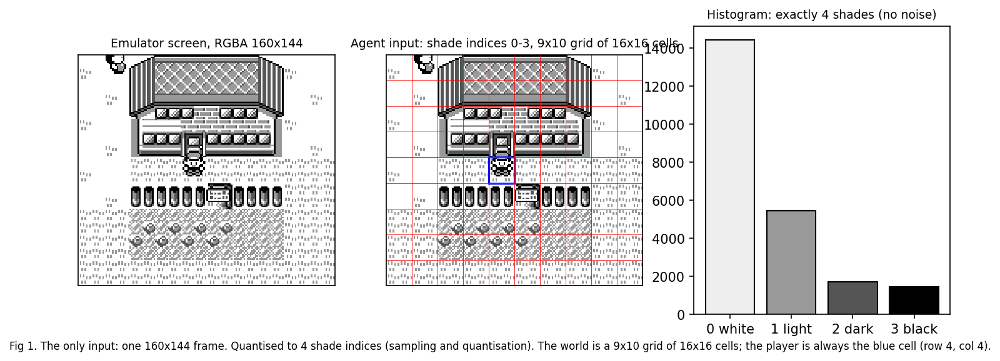
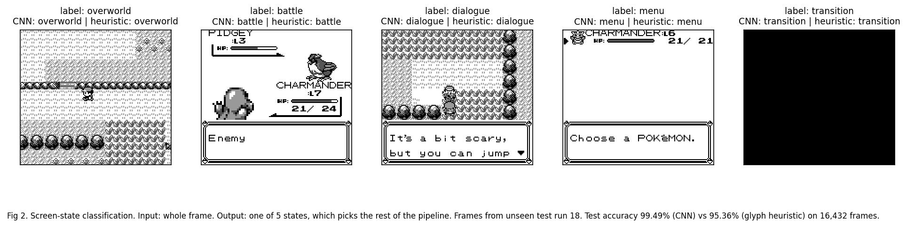
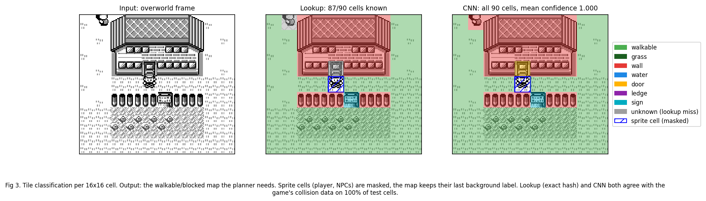
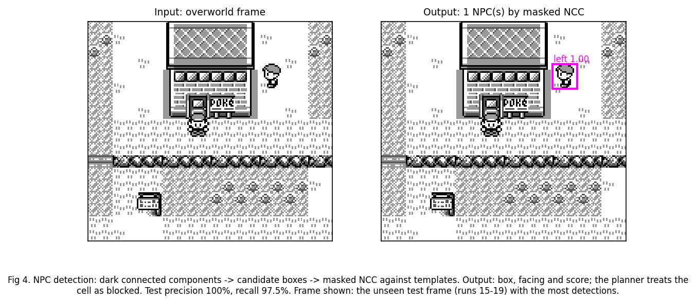
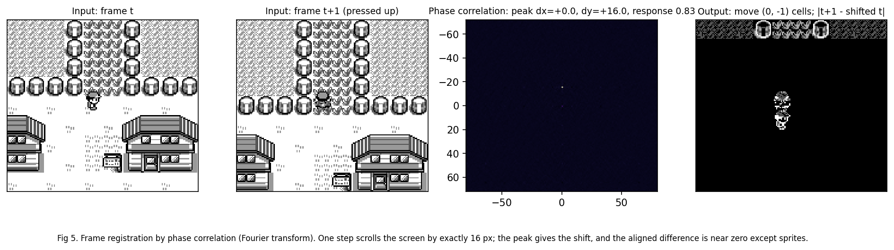
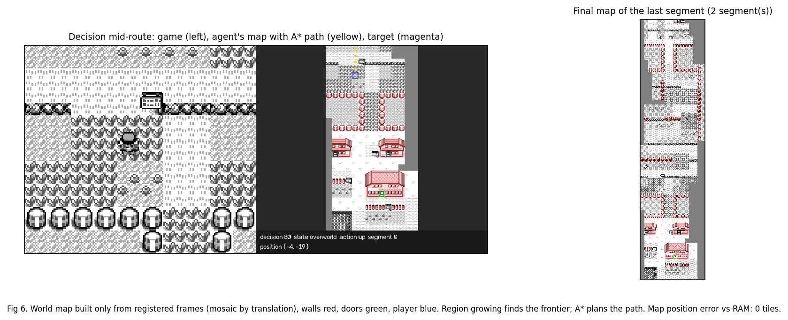
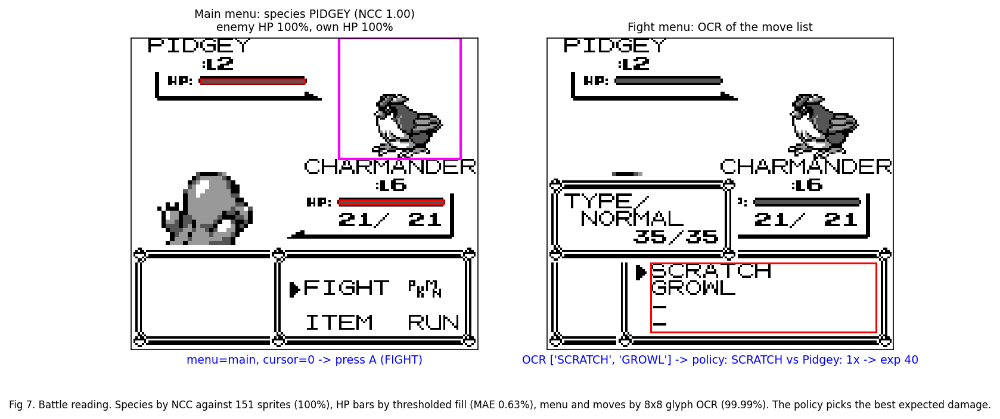
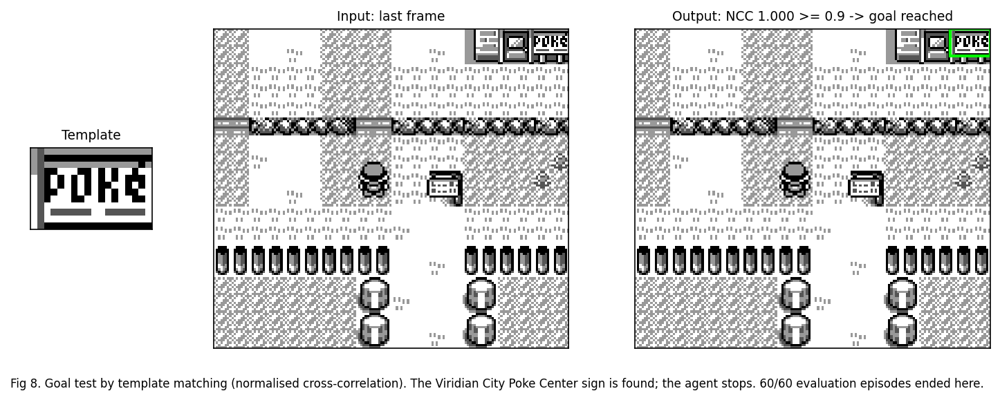
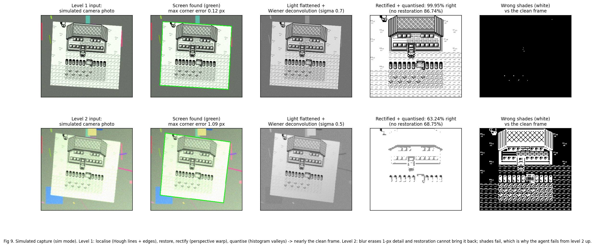

<h1 class="title">Input and Output Images</h1>

Computer Vision (MCA509D-5) — CIA 3

PixelTrainer — A Vision-Only Agent that Plays Pokémon Red

Achindra Sharma — 2547105 (Individual Submission)

4MCA A

Repository: <a href="https://github.com/Achindra2003/pixeltrainer">github.com/Achindra2003/pixeltrainer</a>

This document collects the input and output images of my project. PixelTrainer plays Pokémon Red only by looking at the screen, so each stage of the pipeline takes an image in and produces something it can act on. In every figure the **input is on the left and the output on the right**. All of them were generated by the project code (`python tools/make_figures.py`), from a real run (seed 0) or from test runs 15–19, which the models never saw during training. A full explanation and justification of each figure is in Section 5 of the User Manual, and a video of one complete episode is submitted alongside as `demo.mp4`.

::: item
## 1. The input image

**Input:** one 160×144 Game Boy frame from the emulator. **Output:** the same frame quantised to 4 shade indices on its fixed 9×10 grid of 16×16 cells, and its histogram (exactly four shades).

:::

::: item
## 2. Screen state

**Input:** a whole frame. **Output:** one of 5 screen states (overworld, battle, dialogue, menu, transition). CNN accuracy on 16,432 unseen frames: 99.49%.

:::

::: item
## 3. Tile classes

**Input:** an overworld frame. **Output:** a class for every 16×16 cell (walkable, wall, door, sign…), the map the planner searches. Agreement with the game's collision data on 266,883 unseen cells: 100%.

:::

::: item
## 4. NPC detection

**Input:** an overworld frame. **Output:** a box, facing direction and NCC score for each person. Unseen tests: 100% precision, 97.5% recall.

:::

::: item
## 5. Registration

**Input:** two consecutive frames. **Output:** the phase-correlation peak and the move in whole cells. Map position error against the game's memory: 0 tiles on 12,212 frames.

:::

::: item
## 6. World map and plan

**Input:** the registered frames of one episode. **Output:** the world map built from them, with the A\* path (yellow) to the frontier target (magenta).

:::

::: item
## 7. Battle reading and choice

**Input:** a battle frame. **Output:** the enemy species (NCC), both HP fractions, the menu text (OCR) and the move the policy picks. Unseen tests: species 100% (716/716).

:::

::: item
## 8. Goal reached

**Input:** the last frame of the episode and the sign template. **Output:** the matched sign (NCC 1.000 ≥ 0.9), so the agent stops. All 60/60 evaluation episodes reached this goal.

:::

::: item
## 9. Camera mode

**Input:** a simulated camera photo of the screen (tilted, blurred, unevenly lit, noisy). **Output:** a clean 4-shade frame after localise → restore → rectify → quantise. Level 1 (top row) succeeds with 99.95% of pixels correct; level 2 (bottom row) fails, shown on purpose as the method's limit.

:::
